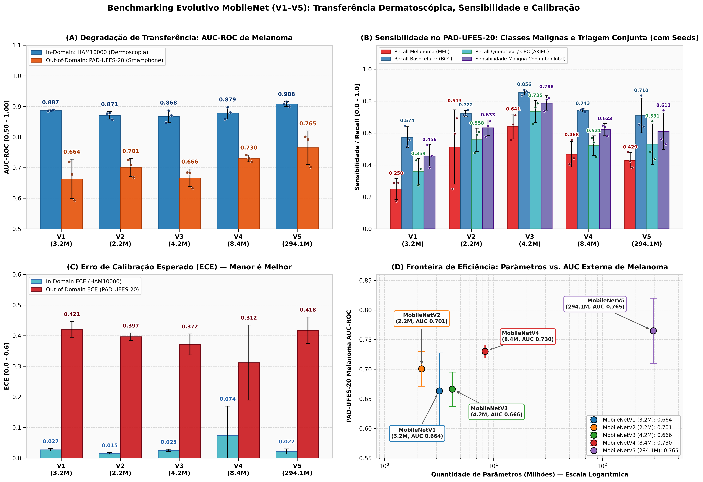
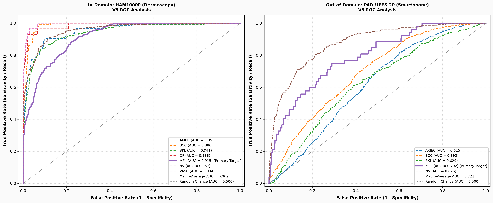
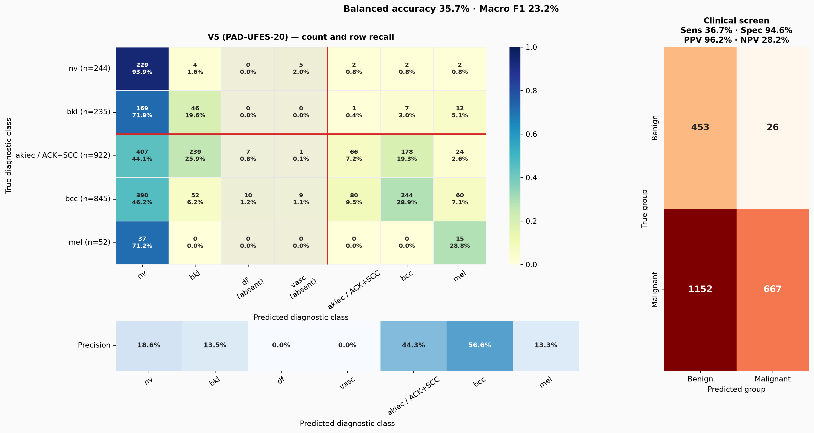
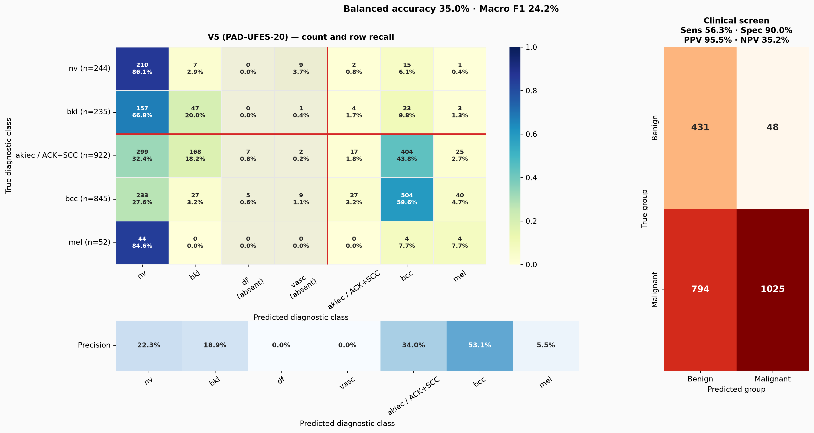
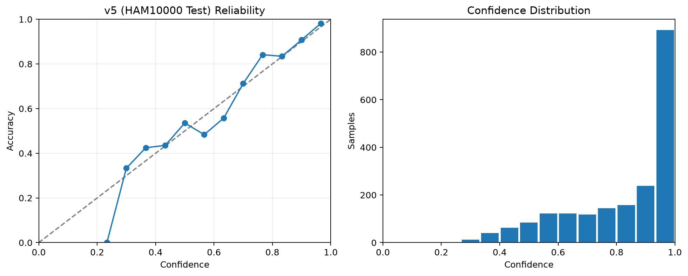
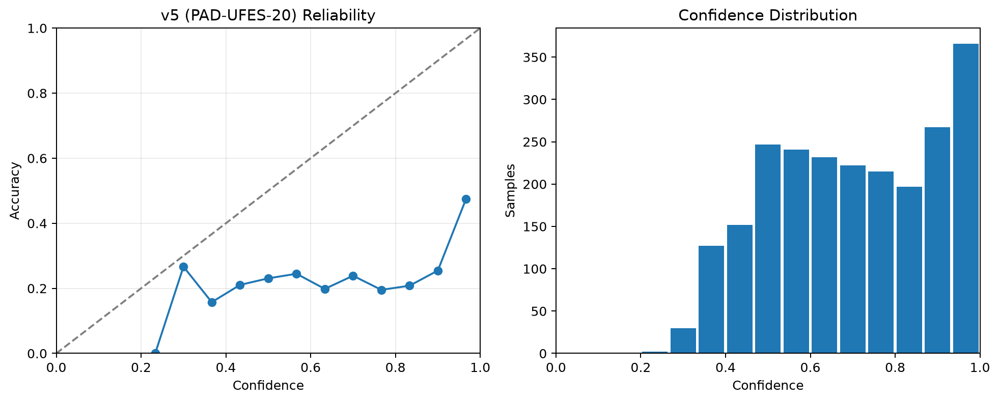
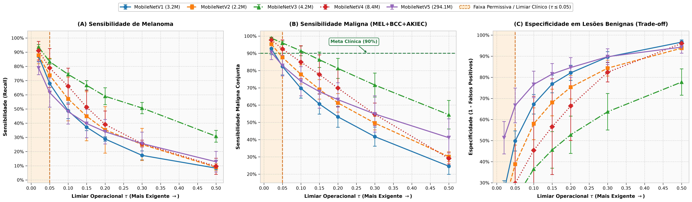
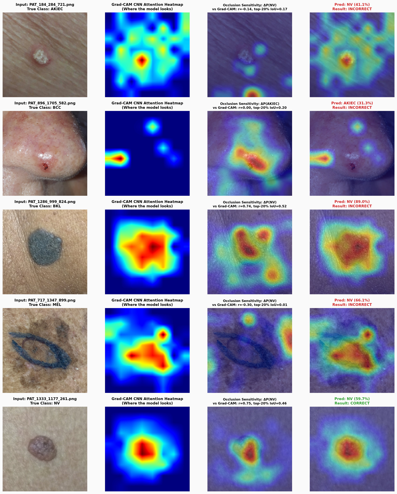
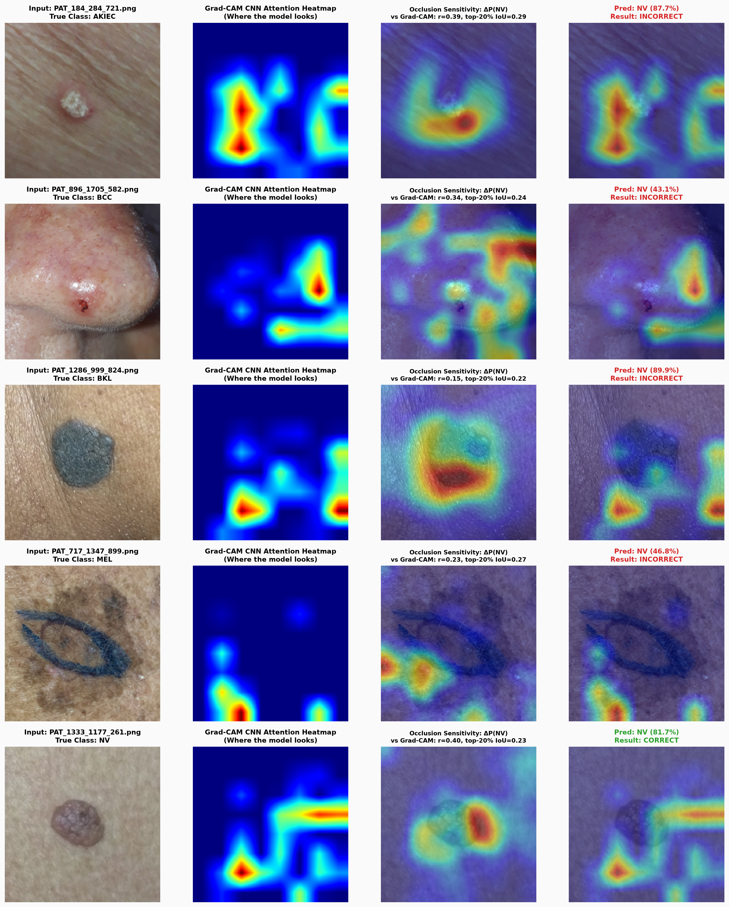

# Capítulo 5: Resultados e Análise Experimental

> **Referência da Monografia:** MURAKAMI, Lucas Kaito. *Benchmarking de Arquiteturas MobileNet para Detecção de Lesões Dermatológicas*. Trabalho de Conclusão de Curso (Bacharelado em Ciência da Computação) — Universidade do Vale do Rio dos Sinos (UNISINOS), Porto Alegre, 2026. Orientador: Prof. Dr. Flavio Moreira de Oliveira.

---

## 5.1 Execução e Controle de Qualidade

A campanha experimental consolidou 18 *checkpoints* de treinamento: 15 execuções correspondentes à comparação principal de cinco arquiteturas avaliadas independentemente sob três sementes aleatórias fixas (`42`, `43` e `44`), e três execuções destinadas ao estudo de ablação da MobileNetV3 fixadas na semente `42`. Todas as execuções utilizaram a partição estrita por grupos de lesões (`lesion_id`) para evitar vazamento de dados (*zero-leakage*).

---

## 5.2 Comparação das Arquiteturas

A Tabela 1 resume a comparação principal. A AUC de melanoma mede discriminação binária para `MEL`; a AUC macro externa considera as cinco classes presentes no PAD-UFES-20; e a sensibilidade maligna corresponde ao mecanismo conjunto calibrado no `HAM-val`.

**Tabela 1 — Desempenho das arquiteturas ($\text{média} \pm \text{desvio-padrão}$)**

| Modelo | Parâmetros | HAM MEL AUC | PAD MEL AUC | PAD macro AUC | PAD sens. maligna | PAD ECE |
| :--- | :---: | :---: | :---: | :---: | :---: | :---: |
| **MobileNetV1** | 3,2 M | $0,8867 \pm 0,0017$ | $0,6635 \pm 0,0523$ | $0,6501 \pm 0,0150$ | $0,4561 \pm 0,0582$ | $0,4205 \pm 0,0210$ |
| **MobileNetV2** | 2,2 M | $0,8707 \pm 0,0099$ | $0,7007 \pm 0,0239$ | $0,6677 \pm 0,0063$ | $0,6329 \pm 0,0402$ | $0,3967 \pm 0,0098$ |
| **MobileNetV3** | 4,2 M | $0,8680 \pm 0,0164$ | $0,6664 \pm 0,0236$ | $0,6749 \pm 0,0140$ | **$0,7883 \pm 0,0367$** | $0,3715 \pm 0,0280$ |
| **MobileNetV4** | 8,4 M | $0,8786 \pm 0,0160$ | $0,7301 \pm 0,0090$ | $0,6898 \pm 0,0093$ | $0,6227 \pm 0,0296$ | **$0,3120 \pm 0,1001$** |
| **MobileNetV5** | 294,1 M | **$0,9081 \pm 0,0064$** | **$0,7650 \pm 0,0449$** | **$0,7277 \pm 0,0168$** | $0,6111 \pm 0,0936$ | $0,4178 \pm 0,0352$ |

A V5 obteve a maior AUC média observada de melanoma nos dois domínios e a maior AUC macro média observada no PAD-UFES-20. O resultado, entretanto, veio acompanhado de 294,1 milhões de parâmetros e não se converteu na maior sensibilidade média do mecanismo maligno nem no menor ECE externo estimado. Dessa forma, não há um vencedor universal, e as posições são descritivas para as três sementes avaliadas.

A V4 apresentou a maior AUC externa média observada de melanoma entre os modelos menores e o menor ECE médio estimado no PAD-UFES-20. Segundo número de parâmetros e médias observadas, ela constitui um compromisso descritivo de discriminação externa dentro desse grupo, devendo ter sua estabilidade confirmada em outro conjunto clínico. A V3, por sua vez, apresentou a maior sensibilidade média observada de triagem maligna ($78,83\%$), ainda que suas AUCs fossem inferiores às da V5.

Ao transferir os limiares operacionais da política `sens90` ajustados no `HAM-val` para o conjunto clínico externo, a Sensibilidade média de Melanoma isolada no PAD-UFES-20 sofreu queda generalizada em relação à meta de 90%:
* **V3:** $66,7\%$ (variando de $63,5\%$ a $71,2\%$)
* **V2:** $53,9\%$
* **V4:** $53,8\%$
* **V5:** $39,1\%$ (com $48,1\%$ na semente 42 e mínima de $28,9\%$ na semente 44)
* **V1:** $31,4\%$

Ao mesmo tempo, a expressiva sensibilidade maligna da V3 esteve atrelada a uma postura de corte mais liberal, o que degradou a Especificidade sobre as lesões benignas no PAD-UFES-20 para a faixa de $35\%$ a $55\%$, gerando uma proporção substancial de falsos positivos diagnósticos.

*Figura 1 — Comparação de métricas entre HAM10000 e PAD-UFES-20.*

---

## 5.3 Variação entre Sementes

A repetição mostrou que estabilidade interna não implica estabilidade externa. A V1 teve desvio-padrão de apenas $0,0017$ na AUC de melanoma do `HAM-test`, mas $0,0523$ no PAD-UFES-20. A V5 também foi estável no `HAM-test` ($\pm 0,0064$) e variável externamente ($\pm 0,0449$ na AUC de melanoma e $\pm 0,0936$ na sensibilidade maligna).

Na V5, a semente 43 foi selecionada na época 10, enquanto as sementes 42 e 44 foram selecionadas nas épocas 20 e 39. A semente 43 alcançou PAD MEL AUC de $0,7018$ (abaixo de $0,7923$ e $0,8010$ nas outras execuções), mas obteve sensibilidade maligna de $0,7422$ (acima de $0,5618$ e $0,5294$). Isso demonstra que AUC e sensibilidade em um ponto operacional não são intercambiáveis.

---

## 5.4 Mudança de Domínio (Dataset Shift)

Para a V5, a AUC média de melanoma caiu de $0,9081$ no `HAM-test` para $0,7650$ no PAD-UFES-20. Na semente 42, caiu de $0,9155$ para $0,7923$ ($\Delta = -0,1232$), com IC 95% externo de $[0,7315; 0,8547]$. O limiar de melanoma da mesma execução atingiu sensibilidade de $80,73\%$ no `HAM-test` e $48,08\%$ no PAD-UFES-20.

Na classificação multiclasse (`V5/seed42`), a acurácia restrita às cinco classes externas foi $26,41\%$. Os *recalls* via $\arg\max$ foram $7,16\%$ para `AKIEC`, $28,88\%$ para `BCC` e $28,85\%$ para `MEL`, enquanto `NV` alcançou $93,9\%$, refletindo forte ancoragem nas características e *priors* do domínio fonte.

*Figura 2 — Curvas ROC da MobileNetV5 (semente 42) contrastando HAM-test e PAD-UFES-20.*

| V5 — Semente 42 | V5 — Semente 43 |
| :---: | :---: |
|  |  |

*Figura 3 — Matrizes de confusão no PAD-UFES-20 (sementes 42 e 43).*

---

## 5.5 Calibração e Regras de Decisão

Na execução `V5/seed42`, a temperatura $T^* = 0,6565$ reduziu o ECE do `HAM-val` de $0,1156$ para $0,0304$. Após a transformação, o ECE foi $0,0208$ no `HAM-test` e $0,4399$ no PAD-UFES-20 (média nas três sementes de $0,4178 \pm 0,0352$).

| Confiabilidade HAM-test | Confiabilidade PAD-UFES-20 |
| :---: | :---: |
|  |  |

*Figura 4 — Diagramas de confiabilidade da MobileNetV5 (semente 42).*

A correção de *prior* aumentou a acurácia balanceada média no `HAM-test` em todas as arquiteturas:
* **V1:** $0,6511 \to 0,7355$
* **V2:** $0,6495 \to 0,7139$
* **V3:** $0,6486 \to 0,7046$
* **V4:** $0,6472 \to 0,7169$
* **V5:** $0,6617 \to 0,7342$

No PAD-UFES-20, o efeito foi inconsistente devido à inversão severa da prevalência epidemiológica (*Prior Shift*).

*Figura 5 — Varredura contínua de limiares operacionais ($\tau \in [0,00; 0,50]$) no PAD-UFES-20.*

---

## 5.6 Estudo de Ablação

**Tabela 2 — Estudo de ablação da MobileNetV3 (semente 42)**

| Configuração | HAM MEL AUC | PAD MEL AUC | PAD macro AUC | PAD sens. maligna |
| :--- | :---: | :---: | :---: | :---: |
| **Completa** | **$0,8865$** | $0,6821$ | **$0,6946$** | **$0,7367$** |
| **Sem perda focal** | $0,8711$ | **$0,7145$** | $0,6914$ | $0,6531$ |
| **Sem Mixup** | $0,8494$ | $0,6971$ | $0,6845$ | $0,6449$ |
| **Sem amostrador balanceado** | $0,8156$ | $0,6317$ | $0,6521$ | $0,5717$ |

A retirada do amostrador balanceado produziu a maior deterioração conjunta observada ($-0,0709$ na AUC de melanoma interna e $-0,1650$ na sensibilidade maligna externa).

---

## 5.7 Custo Estrutural e Interpretabilidade Visual

A ordenação por complexidade paramétrica foi V2 (2,2 M), V1 (3,2 M), V3 (4,2 M), V4 (8,4 M) e V5 (294,1 M). Os mapas de ativação espacial abaixo contrastam o comportamento de atenção da V4 (Grad-CAM) e V5 (LayerCAM) frente ao ruído clínico do PAD-UFES-20.

| V4 — Semente 43 (Grad-CAM) | V5 — Semente 42 (LayerCAM) |
| :---: | :---: |
|  |  |

*Figura 6 — Mapas de explicabilidade visual no PAD-UFES-20.*
